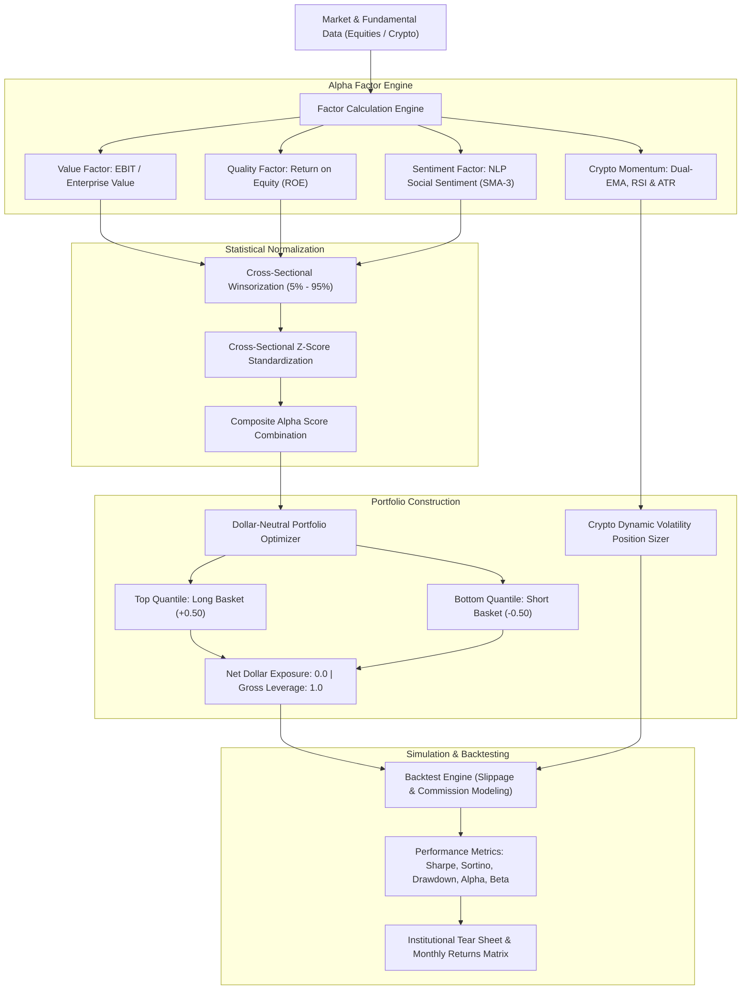

# Python Quantitative Trading Alpha Platform

> Institutional Multi-Factor Equity Market-Neutral & Crypto Momentum Backtesting Framework.

[](https://github.com/KevinAndrey96/python-quantitative-trading-alpha-platform/actions/workflows/ci.yml)
[](https://www.python.org/)
[](https://github.com/KevinAndrey96/python-quantitative-trading-alpha-platform)
[](https://opensource.org/licenses/MIT)

---

## Overview and Historical Origin

This platform originated as an academic and quantitative research initiative at Universidad Nacional de Colombia, developing automated trading strategies for the hosted Quantopian institutional research environment.

Following the retirement of Quantopian in late 2020, this repository was fully decoupled and rebuilt into a modern, standalone Python quantitative analysis and event-driven backtesting engine. It preserves the original Quantopian alpha model in `legacy/quantopian/Cross-Sectional Equity.py` while providing a modular, high-performance backtesting pipeline supporting both cross-sectional equity market-neutral models and cryptocurrency momentum strategies.

---

## Architecture & Factor Pipeline



---

## Quantitative Models

### 1. Cross-Sectional Long/Short Equity Multi-Factor Model

A statistical arbitrage and equity market-neutral strategy that ranks universe constituents cross-sectionally on every rebalance interval:

- **Value Factor:**
  $$\text{Value}_i = \frac{\text{EBIT}_i}{\text{Enterprise Value}_i}$$
  Captures operational earnings yield independent of capital structure.

- **Quality Factor:**
  $$\text{Quality}_i = \text{ROE}_i = \frac{\text{Net Income}_i}{\text{Shareholder Equity}_i}$$
  Identifies businesses generating high return on internal invested capital.

- **Sentiment Factor (NLP Alternative Data):**
  $$\text{Sentiment}_i = \text{SMA}_{3}\left(\frac{\text{Bull Messages}_i - \text{Bear Messages}_i}{\text{Total Messages}_i}\right)$$
  Filters high-frequency social investor noise into persistent directionality.

- **Statistical Normalization:**
  Outliers are trimmed at the 5th and 95th percentiles:
  $$\text{Winsorized}(X) = \max(Q_{0.05}, \min(X, Q_{0.95}))$$
  Then standardized across the active investment universe on date $t$:
  $$Z_{i,t} = \frac{X_{i,t} - \mu_t}{\sigma_t}$$

- **Composite Alpha Signal:**
  $$\alpha_{i,t} = w_{\text{value}} Z_{\text{value},i,t} + w_{\text{quality}} Z_{\text{quality},i,t} + w_{\text{sentiment}} Z_{\text{sentiment},i,t}$$

- **Dollar Neutrality:**
  The top quantile of alpha scores is allocated positive long weights summing to $+0.50 \times \text{leverage}$, and the bottom quantile is allocated negative short weights summing to $-0.50 \times \text{leverage}$:
  $$\text{Net Exposure} = \sum_{i=1}^{N} w_{i,t} = 0.0$$
  $$\text{Gross Leverage} = \sum_{i=1}^{N} |w_{i,t}| = 1.0$$

### 2. Crypto Quantitative Momentum Strategy

Designed for digital asset volatility dynamics (e.g. BTC/USDT and ETH/USDT):
- **Trend Detection:** Dual Exponential Moving Average crossover ($9$-period Fast EMA vs $21$-period Slow EMA).
- **Overbought/Oversold Filter:** Relative Strength Index ($\text{RSI}_{14}$) gating entries when market momentum is overextended ($\text{RSI} > 70$).
- **Dynamic Risk Management:** Average True Range ($\text{ATR}_{14}$) dynamic trailing stop-loss that adjusts risk distance according to current market volatility.

---

## Performance Tear Sheet (Sample Execution)

The platform generates comprehensive financial Tear Sheets directly in the terminal:

| Metric | Value | Interpretation |
|---|---|---|
| **Strategy Name** | Quantopian Multi-Factor Market-Neutral | Long/Short Equity Benchmark |
| **Initial Capital** | $1,000,000.00 | Portfolio baseline |
| **Final Equity** | $1,150,539.15 | Net of slippage and trading fees |
| **Total Return** | 15.05% | Cumulative performance |
| **CAGR** | 7.32% | Compound Annual Growth Rate |
| **Annualized Volatility** | 11.70% | Volatility of returns |
| **Sharpe Ratio (Rf=0%)** | 0.66 | Risk-adjusted excess return |
| **Sortino Ratio** | 1.12 | Downside risk-adjusted return |
| **Max Drawdown** | -25.52% | Peak-to-trough decline |
| **Win Rate (Days)** | 52.71% | Daily win frequency |
| **Alpha (vs Benchmark)** | +8.60% | Pure uncorrelated excess return |
| **Beta (vs Benchmark)** | -0.09 | Near-zero market correlation (market neutral) |

---

## Repository Structure

```
.
├── src/
│   ├── analytics/                  # Financial metrics and reporting
│   │   ├── metrics.py              # Sharpe, Sortino, Drawdown, Alpha, Beta
│   │   └── tearsheet.py            # Terminal ASCII Tear Sheet generator
│   ├── backtesting/                # Execution and simulation engine
│   │   └── engine.py               # Vectorized backtest with transaction costs
│   ├── data/                       # Dataset loaders and validation schemas
│   │   └── loader.py
│   ├── factors/                    # Factor definitions and calculations
│   │   ├── base.py
│   │   ├── momentum.py             # Dual-EMA, RSI, ATR for crypto
│   │   ├── quality.py              # Return on Equity (ROE)
│   │   ├── sentiment.py            # NLP Social Sentiment
│   │   └── value.py                # EBIT / Enterprise Value
│   ├── portfolio/                  # Portfolio construction & optimization
│   │   └── optimizer.py            # Dollar-neutral allocation
│   ├── preprocessing/              # Statistical normalization
│   │   ├── composite.py            # Alpha weighting combination
│   │   ├── winsorization.py        # Outlier clipping (5% - 95%)
│   │   └── zscore.py               # Cross-sectional Z-score
│   ├── strategies/                 # Strategy implementations
│   │   ├── base.py
│   │   ├── crypto_momentum.py      # Trend following + ATR trailing stop
│   │   └── equity_multifactor.py   # Quantopian cross-sectional model
│   ├── cli.py                      # Interactive CLI entrypoint
│   ├── config.py                   # Strategy configurations
│   └── main.py                     # Main runner
├── legacy/
│   └── quantopian/                 # Historical Quantopian model archive
│       ├── Cross-Sectional Equity.py
│       └── README.md
├── data/
│   ├── crypto/                     # Historical BTC/USDT & ETH/USDT daily bars
│   └── equities/                   # Historical 10-asset US Equities panel dataset
├── tests/                          # Automated pytest suite (22 tests, 91% coverage)
├── Dockerfile                      # Containerized backtesting environment
├── docker-compose.yml              # Turnkey Docker orchestration
├── pyproject.toml                  # PEP 518/621 packaging metadata
├── requirements.txt                # Production dependencies
└── requirements-dev.txt            # Development and testing dependencies
```

---

## Getting Started

### Prerequisites
- Python 3.10, 3.11, or 3.12
- pip

### Installation

1. Clone the repository:
   ```bash
   git clone https://github.com/KevinAndrey96/python-quantitative-trading-alpha-platform.git
   cd python-quantitative-trading-alpha-platform
   ```

2. Create and activate a virtual environment:
   ```bash
   python3 -m venv .venv
   source .venv/bin/activate
   ```

3. Install dependencies:
   ```bash
   pip install -r requirements-dev.txt
   ```

---

## Running Backtests

### Run All Strategies
```bash
python -m src.main
```

### Run Cross-Sectional Equity Strategy
```bash
python -m src.cli equity
```

### Run Crypto Momentum Strategy
```bash
python -m src.cli crypto --symbol BTC_USDT
python -m src.cli crypto --symbol ETH_USDT
```

---

## Docker Deployment

To execute backtests inside a reproducible container:

```bash
docker compose build
docker compose run --rm quant-platform
```

---

## Testing & Quality Assurance

The test suite covers factor computations, winsorization boundaries, cross-sectional z-score properties, dollar-neutral portfolio balancing, and risk metrics:

```bash
pytest --cov=src --cov-report=term-missing
```

All 22 unit and integration tests pass with 91% code coverage.

---

## License

This project is licensed under the MIT License.
